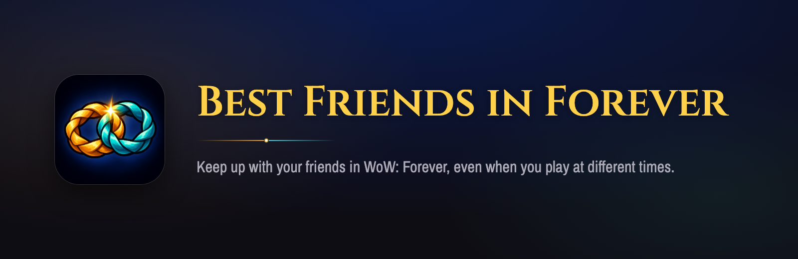
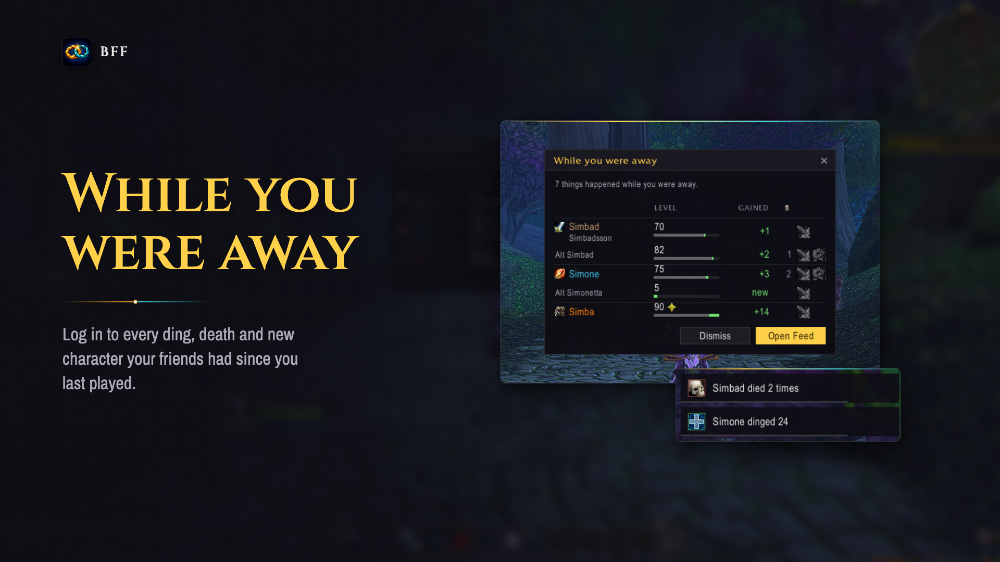
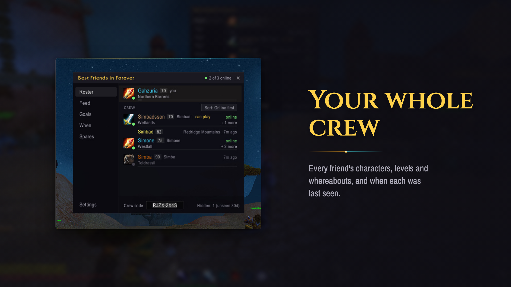
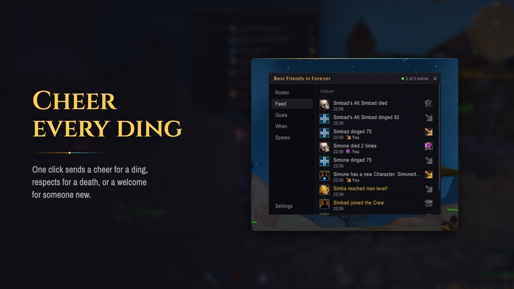
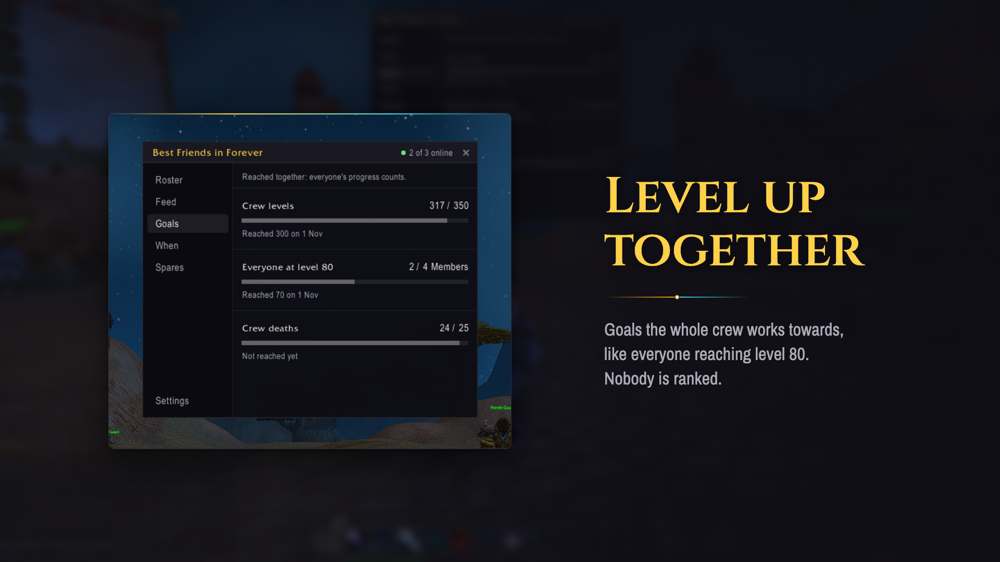
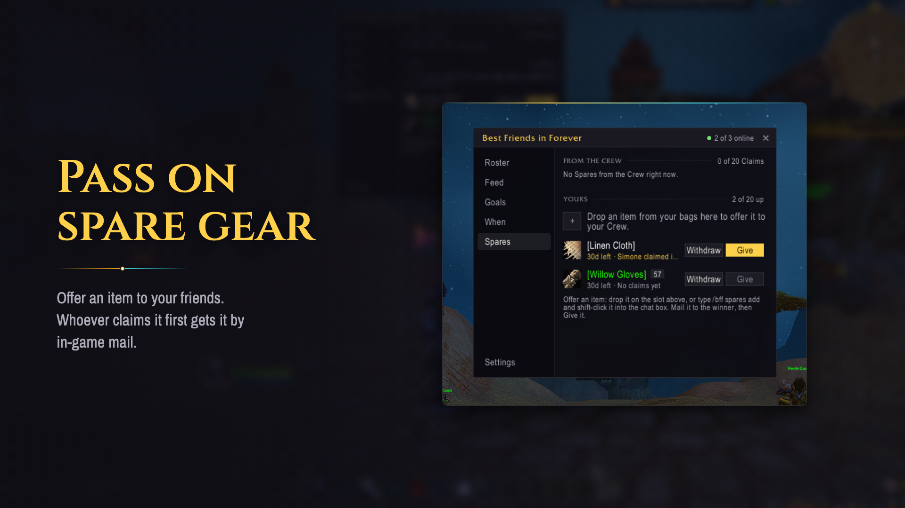
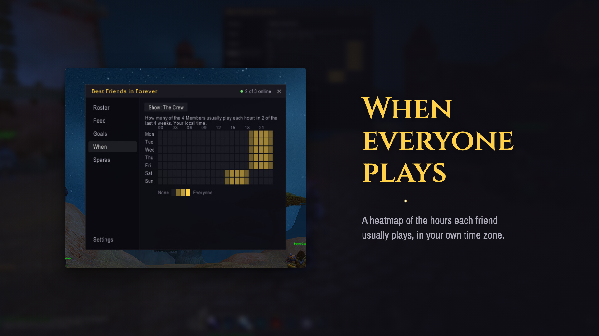

# BFF – Best Friends in Forever



A World of Warcraft: Forever addon for friends who don't always play at the same time. It shows everyone's characters, levels and whereabouts, and tells you what your friends did while you were away. No server, no account, and no shared guild needed.

## What it does

<table>
<tr>
<td width="50%"><br><b>While you were away.</b> On login, every ding, death and new character your friends had since you last played.</td>
<td width="50%"><br><b>Your whole crew.</b> Every friend's characters, levels and whereabouts, and when each was last seen.</td>
</tr>
<tr>
<td><br><b>Cheer every ding.</b> One click sends a cheer for a ding, respects for a death, or a welcome for someone new.</td>
<td><br><b>Level up together.</b> Goals the whole crew works towards. Nobody is ranked.</td>
</tr>
<tr>
<td><br><b>Pass on spare gear.</b> Offer an item to your friends. Whoever claims it first gets it by in-game mail.</td>
<td><br><b>When everyone plays.</b> A heatmap of the hours each friend usually plays, in your own time zone.</td>
</tr>
</table>

## Start a crew

1. Everyone in the group installs BFF.
2. One friend types `/bff start` and shares the crew code.
3. The others type `/bff join <code>`.

## Commands

| Command | What it does |
|---|---|
| `/bff` | Open or close the panel (also a key binding and the minimap button) |
| `/bff feed`, `/bff goals`, `/bff when`, `/bff spares` | Open the panel on that tab |
| `/bff spares add <item>` | Offer an item from your bags: shift-click it in after `add` |
| `/bff start`, `/bff join <code>`, `/bff leave` | Start, join or leave a crew |
| `/bff code` | Show your crew code |
| `/bff name <name>` | Set the name your friends see |
| `/bff settings` | Open Settings |
| `/bff minimap` | Bring back a hidden minimap button |

## Install

- **CurseForge:** [BFF – Best Friends in Forever](https://www.curseforge.com/wow/addons/bff-best-friends-in-forever), or search for it in the CurseForge app.
- **WowUp:** Get Addons → Install from URL, and paste `https://github.com/Shtian/bff-wow`. WowUp picks up new releases from there.
- **By hand:** download `BFF-vX.Y.Z.zip` from the [latest release](https://github.com/Shtian/bff-wow/releases/latest) and unzip it into the game's `Interface\AddOns` folder, so you get `AddOns\BFF\BFF.toc`.

## Development

Libraries aren't committed. Fetch the ones `.pkgmeta` declares into `Libs/` once, and again after a library bump:

```sh
scripts/fetch-libs.sh
```

Tests run under LuaJIT, like WoW's Lua 5.1:

```sh
brew install luajit luarocks
luarocks --lua-version 5.1 --lua-dir "$(brew --prefix luajit)" --local install busted
luarocks --lua-version 5.1 --lua-dir "$(brew --prefix luajit)" --local install luacheck
export PATH="$HOME/.luarocks/bin:$PATH"

luacheck .
busted
```

Design notes: [`docs/design/architecture.html`](docs/design/architecture.html).

### Gallery images

The CurseForge gallery and the banner above are rendered from in-game screenshots with `npm run gallery`. See [`docs/gallery/README.md`](docs/gallery/README.md).

## Releasing

Releases are cut with [bumpy](https://github.com/dmno-dev/bumpy) (see `docs/design/settings-and-release.md`). A PR that changes shipped files (`changedFilePatterns` in `.bumpy/_config.json`) needs a bump file:

```sh
npm install
npx bumpy add --packages "bff:patch" --message "What changed, for the changelog."
```

Merging to `main` opens or updates the "Versioned release" PR. Merging that publishes the GitHub release `bff@X.Y.Z` with the zip and `release.json`, and uploads the zip to CurseForge once the `CF_API_KEY` secret and `CURSEFORGE_PROJECT_ID` variable are set.

## License

MIT, see [`LICENSE`](LICENSE). The libraries in `Libs/` keep their own licenses.
