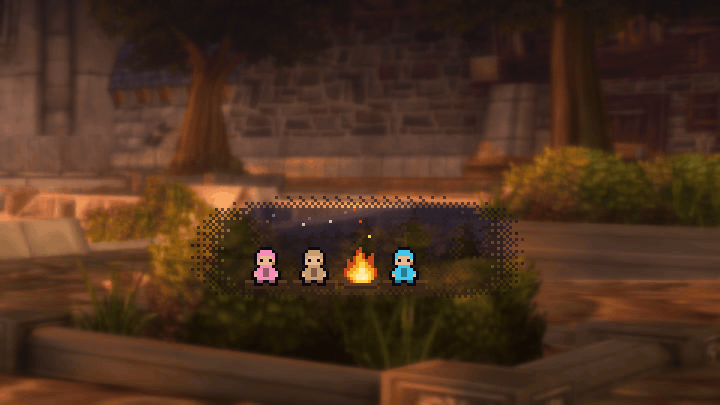
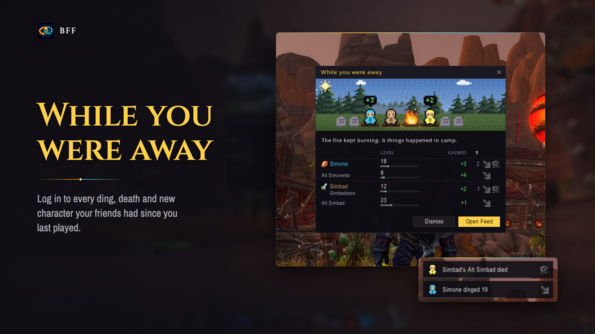
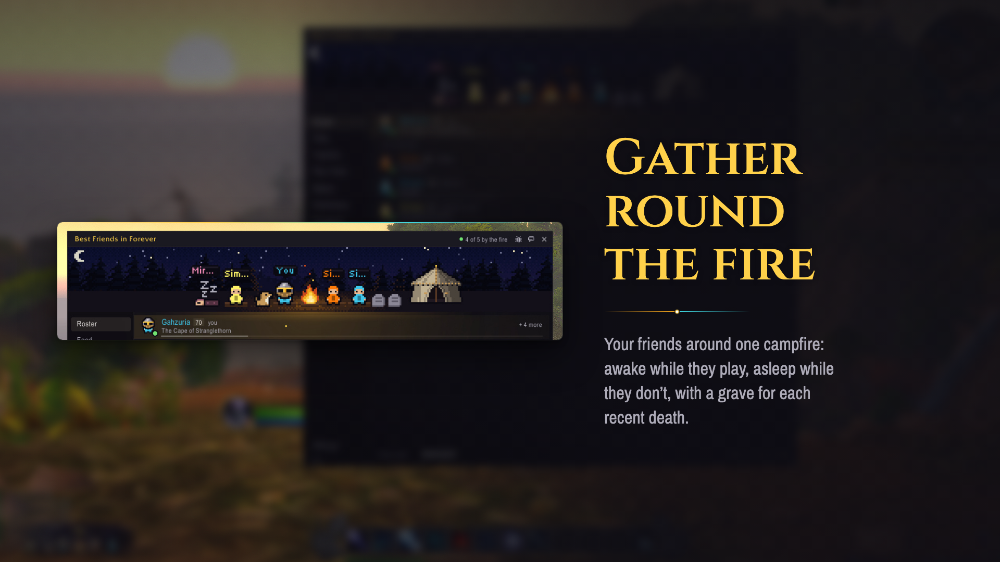
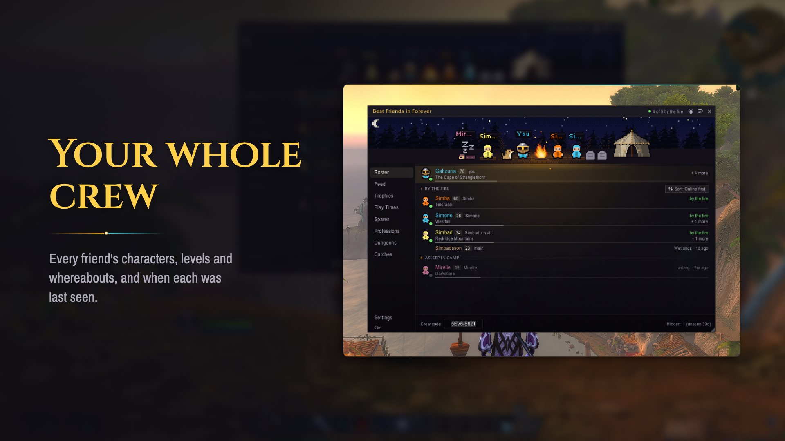
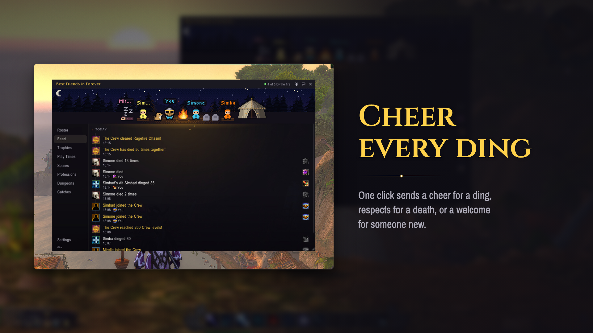
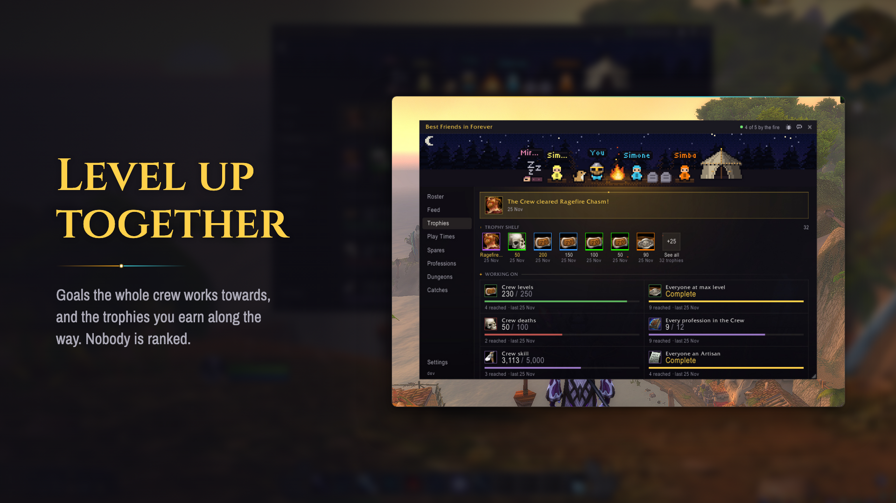
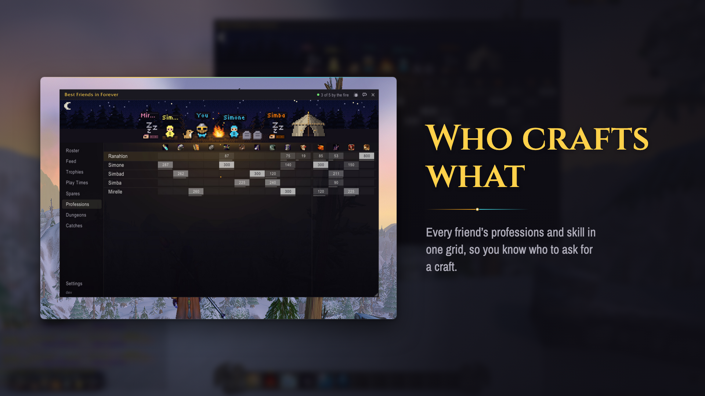
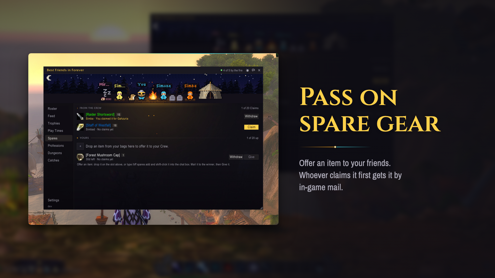
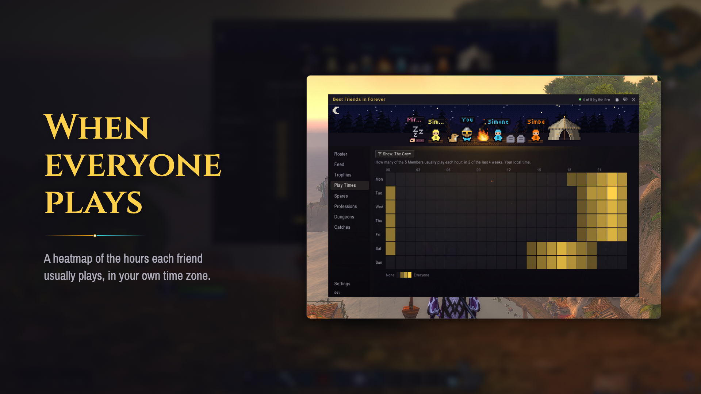
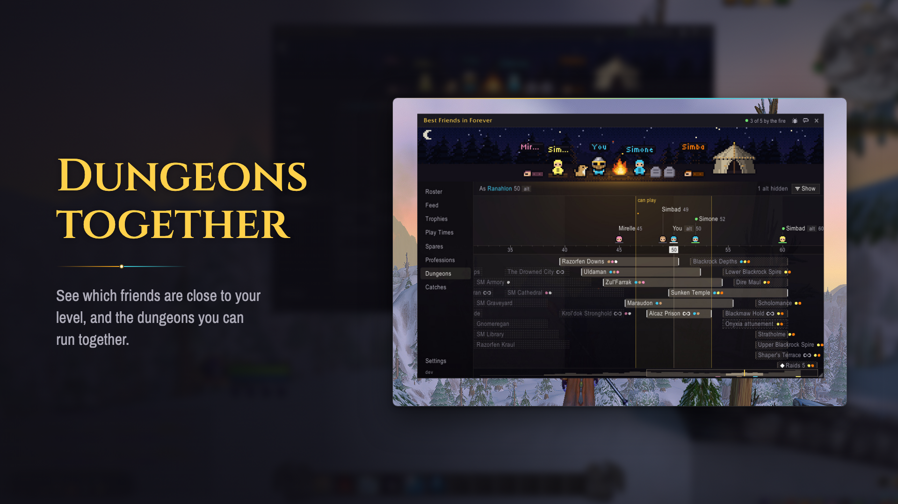

**Keep up with your friends in WoW: Forever, even when you play at different times.**

BFF is for a small group of friends who don't always play at the same time. It shows everyone's characters, levels and whereabouts, tells you what your friends did while you were away, and can keep a little campfire on screen with every friend who's online. No server, no account, and no shared guild needed.

## Get started

1. Everyone in the group installs BFF.
2. One friend types `/bff start` and shares the crew code (on Discord, by text, however you like).
3. The others type `/bff join <code>`.

That's it. Type `/bff` or click the minimap button to open the panel.

## What it does

### The Pocket Camp: a campfire on screen

A small pixel campfire you can keep on screen while you play, with every friend who's online sitting around it, you included. Players asked for it in the comments here.

- **See what everyone's doing right now:** fighting, fishing, crafting, gathering, flying, shopping at the auction house, resting at an inn, AFK, or standing in a dungeon doorway. Druids and shamans show up in their forms.
- **Watch the news happen:** a ding gets a gold star, a max level bursts into sparks, a death turns into a skeleton, and a crew goal makes the fire flare purple.
- **Hover a friend** to see their character, level and zone. Click the Camp to open BFF, and drag it anywhere.

It's on by default; turn it off in Settings if you'd rather not have it.

### While you were away

When you log in, see every level-up (ding), death and new character your friends had since you last played.

### Gather round the fire

The Camp is a small pixel campsite at the top of the panel. Friends who are online sit by the fire and the rest sleep in bedrolls. A recent death leaves a grave, paying respects puts a flower on it, and a fresh max level gets a spark.

### Your whole crew

Every friend's characters, levels and whereabouts, and when each was last seen. Alts are grouped under the person who plays them, and map pins show where everyone is.

### Cheer every ding

One click sends a cheer for a ding, respects for a death, or a welcome for someone new. Your friend sees it as a pop-up, with an optional sound.

### Level up together

Goals the whole crew works towards, like everyone reaching level 60, and trophies for what you do together, like clearing a dungeon or a raid. Nobody is ranked.

### Who crafts what

Every friend's professions and skill in one grid, so you know who to ask for a craft. Hover a tile to see which characters have it.

### Pass on spare gear

Offer an item from your bags to your friends. Whoever claims it first gets it by in-game mail.

### When everyone plays

A heatmap of the hours each friend usually plays, in your own time zone, so you can find a time to play together.

### Dungeons together

See which friends are close to your level, and the dungeons you can run together. Click a friend to see the dungeons that fit you both.

### Fish together

A field guide of the crew's fishing catches. Every type of fish is filled in by whoever caught it first, with when and where, and you can see what the crew still hasn't caught. Rare finds, like Nat Pagle's fish, are news you can cheer.

## Commands

| Command | What it does |
|---|---|
| `/bff` | Open or close the panel (also a key binding and the minimap button) |
| `/bff start`, `/bff join <code>`, `/bff leave` | Start, join or leave a crew |
| `/bff code` | Show your crew code, to invite another friend |
| `/bff name <name>` | Set the name your friends see |
| `/bff roster`, `/bff feed`, `/bff trophies`, `/bff playtimes`, `/bff spares`, `/bff professions`, `/bff dungeons`, `/bff catches`, `/bff whatsnew` | Open the panel on that tab |
| `/bff spares add <item>` | Offer an item: type `add`, then shift-click the item in your bags |
| `/bff settings` | Open Settings |
| `/bff minimap` | Bring back a hidden minimap button |
| `/bff help`, `/bff help <command>` | List the commands, or say more about one |

## FAQ

**Do all my friends need BFF?**
Yes. Everyone in the crew needs it installed, and everyone joins with the same crew code.

**Do we need to be in the same guild?**
No. You do need to be on the same realm and the same faction: WoW's chat doesn't cross factions or reach other realms. Connected realms haven't been tested yet.

**How does my news reach a friend who's offline?**
BFF has no server, so news travels between players who are online at the same time. Any crew member who has your news passes it on, even if you're offline. A crew whose members are never online together won't see each other's news.

**Why is my friend's news late?**
WoW blocks addon messages in combat, dungeons and raids, so BFF waits until you leave and then sends everything. A message can also get lost now and then. The next sync fills the gap, so things catch up but aren't instant.

**Who can see my data?**
Only people with your crew code. There's no owner, kick or ban. To hide someone just for yourself, use Remove. To shut someone out, start a new crew and share the new code with the others. You can also turn on **Appear offline** in Settings to stop sharing for a while.

**I can't join a crew, or nothing happens.**
BFF uses one of your character's custom chat channels, and WoW allows about 10. If you're at the cap, leave a channel and `/reload`. BFF works with one crew at a time.

**How long is history kept?**
The feed keeps 30 days or 200 entries, whichever runs out first. Friends unseen for 30 days are hidden from the panel.

**Something's broken. How do I report it?**
Type `/bff report`, copy the text, and paste it into a [GitHub issue](https://github.com/Shtian/bff-wow/issues) or a comment here, with what you did and what went wrong. The report includes your crew's character names.

## Thanks

Some of BFF came from ideas players left in the comments here:

- **kayloohoo** asked for a small campfire to keep on screen, with little animations for what friends are doing. That became the Pocket Camp.
- **absolutezabba12** asked for a setting to turn the map location off, more accurate positions, and the Camp's characters on the map in place of dots. That became the map pin setting, live positions and the Camp figures as map pins.
- **TheDolmenDuke** asked for the Pocket Camp to show a friend at a shop or the auction house, in combat and handing in a quest, and for a dungeon icon of its own. That became the Pocket Camp's poses for what each friend is doing right now.
- **Moonghost** asked for the Pocket Camp to show friends in their shapeshift forms. That became the bear, cat, travel, aquatic and moonkin forms and Ghost Wolf by the fire.

Have an idea? Leave a comment.

## Links

- **Discord:** [join the BFF Discord](https://discord.gg/5bgyqhHFv) to chat, share an idea, or follow new releases
- **Bugs and ideas:** a comment here, [GitHub issues](https://github.com/Shtian/bff-wow/issues), or the Discord
- **Source code:** [github.com/Shtian/bff-wow](https://github.com/Shtian/bff-wow)
- **Support:** if BFF brings your crew together and you'd like to say thanks, you can [buy me a coffee](https://buymeacoffee.com/mltdwymkxn). It's never expected.
